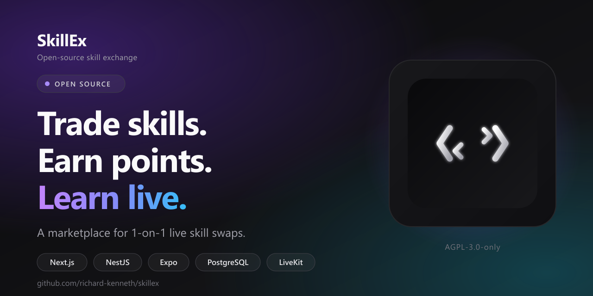
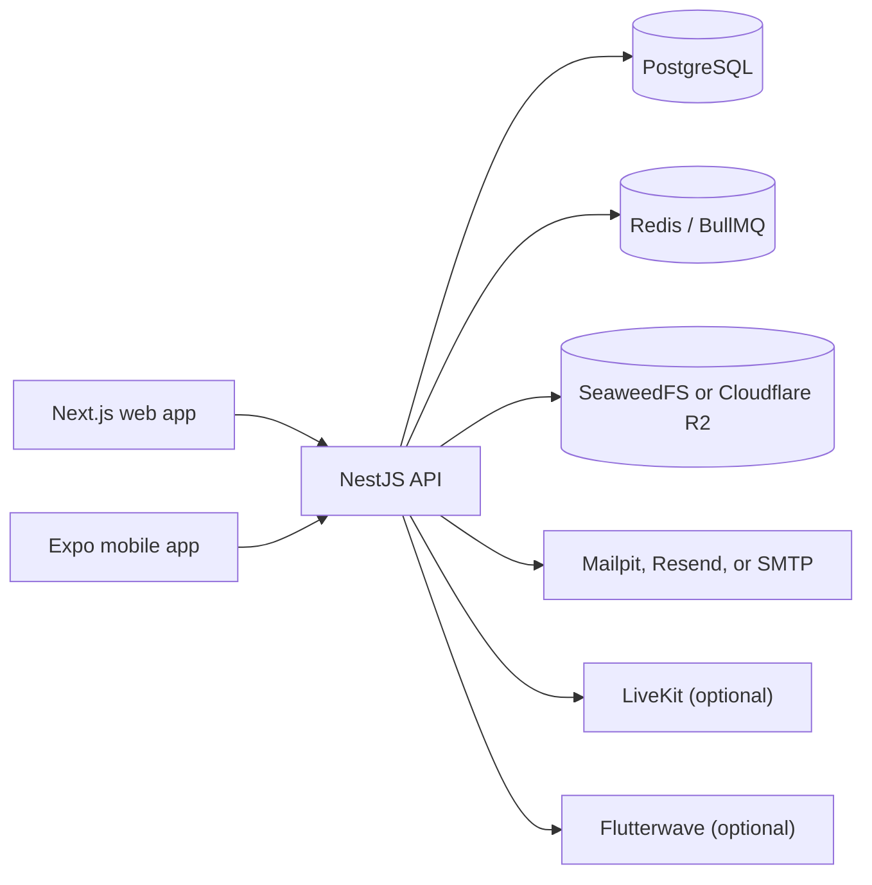

# SkillEx

[](https://github.com/richard-kenneth/skillex/actions/workflows/ci.yml)
[](./LICENSE)
[](./CONTRIBUTING.md)

SkillEx is an open-source skill-exchange marketplace: trade skills, earn points, and learn live. Teach what you know, learn what you want, and settle the difference with points when a straight swap is not possible.



The project is a pnpm + Turborepo monorepo with a Next.js web app, a NestJS API, an Expo / React Native mobile app, and a shared TypeScript package.

> **Status:** pre-launch. The repository is being prepared for its first public release. The local development stack is designed to run with **zero paid accounts**.

**Live site:** [landing page and waitlist](https://skil-ex2-web.vercel.app/?utm_source=github&utm_medium=readme&utm_campaign=v0.1.0). The full marketplace is not hosted as a public demo yet; the local stack is the supported way to try the product today.

## Quick start

### Prerequisites

- **Node.js 22+**
- **pnpm 10.33.2** (`corepack enable` or `npm install -g pnpm@10.33.2`)
- **Docker Desktop** (or Docker Engine with Compose v2)

### Run it

```bash
git clone https://github.com/richard-kenneth/skillex.git
cd skillex
pnpm install
pnpm run setup
pnpm dev
```

> `setup` is also a pnpm built-in command, so run this project's script as `pnpm run setup`.
>
> On Windows, setup also checks the default Docker Desktop install location when `docker` is not on `PATH`.

`pnpm run setup` is idempotent. It:

1. creates `apps/api/.env`, `apps/web/.env.local`, and `apps/mobile/.env` from the example files;
2. generates local-only secrets;
3. starts PostgreSQL, Redis, Mailpit, and SeaweedFS with Docker Compose;
4. builds the shared package, generates the Prisma client, applies migrations, and seeds demo data.

Host ports are configurable. If PostgreSQL, Redis, Mailpit, or SeaweedFS is
already installed on this machine, change the conflicting `*_PORT` value in the
repository `.env` file and rerun `pnpm run setup`. Setup stops with an
actionable error instead of connecting to the wrong service, and rewrites the
local URLs in `apps/api/.env` to match. Core services bind to `127.0.0.1`.

Then open:

| Service                | URL                                                        |
| ---------------------- | ---------------------------------------------------------- |
| Web app                | <http://localhost:3000>                                    |
| API                    | <http://localhost:3001/api>                                |
| API health             | <http://localhost:3001/health>                             |
| Mailpit (caught email) | <http://localhost:8025>                                    |
| SeaweedFS UI           | <http://localhost:9001>                                    |
| SeaweedFS S3 API       | <http://localhost:9000> (`skillex` / `skillex-dev-secret`) |

### Demo login

```text
Email:    demo@skillex.dev
Password: Password123!
```

The seed also creates `ada@skillex.dev`, `grace@skillex.dev`, `linus@skillex.dev`, `maya@skillex.dev`, and `sam@skillex.dev` with the same password. All seeded data is local-only and is skipped in production unless `SEED_DEMO_DATA=true`.

## What works without third-party accounts

| Feature        | Local default                                                              |
| -------------- | -------------------------------------------------------------------------- |
| Database       | PostgreSQL in Docker                                                       |
| Cache / queues | Redis in Docker                                                            |
| Email          | Mailpit at `localhost:1025`; read it at `localhost:8025`                   |
| File uploads   | SeaweedFS bucket `skillex-uploads`                                         |
| Payments       | Local mock: purchases credit points, withdrawals succeed, no external call |
| Exchange rates | Transparent fallback rates                                                 |
| Web push       | Disabled until VAPID keys are set                                          |
| Analytics      | Disabled until PostHog keys are set                                        |
| OAuth          | Disabled until a provider's client ID and secret are set                   |
| Live video     | Disabled until the optional LiveKit profile and keys are enabled           |

Optional integrations fail soft: the API logs that the feature is disabled instead of refusing to start. The exception is a _partially_ configured group, such as a Google client ID without its secret; startup validation rejects that with a clear error.

## Optional integrations

### Live video with LiveKit

Start the optional container:

```bash
docker compose --profile video up -d
```

Then set these in `apps/api/.env` and restart the API:

```env
NEXT_PUBLIC_LIVEKIT_URL=ws://localhost:7880
LIVEKIT_API_KEY=devkey
LIVEKIT_API_SECRET=secret
```

The `--dev` LiveKit container uses the key `devkey` and secret `secret`. These values are for local development only. If all three values are empty, video features are disabled cleanly.

### Payments with Flutterwave test mode

Without keys, non-production environments use the local mock. To exercise the real Flutterwave sandbox flow:

1. Create a Flutterwave account and copy the **test** keys from the dashboard.
2. Set the API values in `apps/api/.env`:

   ```env
   FLUTTERWAVE_SECRET_KEY=FLWSECK_TEST-...
   FLUTTERWAVE_WEBHOOK_SECRET_HASH=...
   ```

3. Set the public key in `apps/web/.env.local`:

   ```env
   NEXT_PUBLIC_FLUTTERWAVE_PUBLIC_KEY=FLWPUBK_TEST-...
   ```

4. Point the Flutterwave webhook at your tunnel, for example `https://<your-tunnel>/api/points/webhook`, and use the same webhook secret hash in the dashboard and the API env.
5. If you test the web app through a tunnel, add the tunnel origin to `DEV_EXTRA_ORIGINS` in `apps/api/.env`.

Never use live keys locally, and never commit `.env` files. Flutterwave test-mode cards and bank accounts are listed in the Flutterwave dashboard.

### Email with Resend or SMTP

Mailpit is the zero-config default. To use Resend, set `RESEND_API_KEY` and `ONBOARDING_EMAIL_FROM`; to use another SMTP server, set `EMAIL_TRANSPORT=smtp` and the `SMTP_*` values. `EMAIL_TRANSPORT=disabled` turns email into a no-op.

### Production object storage

The local stack uses SeaweedFS. In production, set `R2_ACCESS_KEY_ID`, `R2_SECRET_ACCESS_KEY`, `R2_BUCKET_NAME`, `R2_ENDPOINT`, and `R2_PUBLIC_URL` for Cloudflare R2. If the R2 group is incomplete, upload endpoints return `503` instead of crashing the API.

### OAuth, push, analytics, and FX

- **Google / LinkedIn OAuth:** set both values of the provider pair; otherwise the provider is not registered.
- **Web push:** set `VAPID_PUBLIC_KEY` and `VAPID_PRIVATE_KEY` (plus `VAPID_EMAIL`) in the API and `NEXT_PUBLIC_VAPID_PUBLIC_KEY` in the web app.
- **PostHog:** set `POSTHOG_PROJECT_TOKEN` and `POSTHOG_HOST` in the API and the corresponding `NEXT_PUBLIC_POSTHOG_*` values in the web app.
- **Exchange rates:** set `OER_APP_ID` to use Open Exchange Rates; otherwise transparent fallback rates are used.

The complete reference, including required values, defaults, optional groups, and legacy variables, is in [`docs/env-vars.md`](./docs/env-vars.md). The example files are [`apps/api/.env.example`](./apps/api/.env.example), [`apps/web/.env.example`](./apps/web/.env.example), and [`apps/mobile/.env.example`](./apps/mobile/.env.example).

## Commands

| Command                       | What it does                                              |
| ----------------------------- | --------------------------------------------------------- |
| `pnpm run setup`              | Create env files, start local services, migrate, and seed |
| `pnpm dev`                    | Start the API and web app in watch mode                   |
| `pnpm build`                  | Build all packages and apps                               |
| `pnpm lint`                   | Run ESLint across the workspace                           |
| `pnpm lint:fix`               | Apply ESLint fixes                                        |
| `pnpm typecheck`              | Typecheck every package                                   |
| `pnpm test`                   | Run the test suites                                       |
| `pnpm format`                 | Format source files with Prettier                         |
| `pnpm format:check`           | Check formatting without writing                          |
| `pnpm db:up` / `pnpm db:down` | Start / stop the local Docker services                    |
| `pnpm db:reset`               | Delete local volumes and recreate the services            |

Useful setup flags: `pnpm run setup -- --skip-install`, `--skip-docker` (services already running), and `--skip-seed`.

### Reset the local database

```bash
pnpm db:reset
pnpm run setup -- --skip-install
```

`db:reset` deletes the Docker volumes. The second command reapplies migrations and reseeds the demo data.

## Architecture at a glance



The web and mobile apps call the API over HTTP and SSE. The API owns PostgreSQL, Redis/BullMQ jobs, email, storage, payments, and LiveKit tokens. See [`docs/architecture.md`](./docs/architecture.md) for module-level detail, core flows, and known constraints.

## Project structure

```text
skillex/
├── apps/
│   ├── api/          # NestJS REST API, Prisma, Better Auth, BullMQ
│   ├── mobile/       # Expo / React Native app
│   └── web/          # Next.js App Router frontend
├── packages/
│   └── shared/       # Shared types, schemas, constants, translations
├── docs/             # Architecture, environment, mobile, ADR, and legal docs
├── scripts/setup.mjs # One-command local setup
├── docker-compose.yml
└── turbo.json
```

## Mobile

The mobile app uses Expo development builds and native modules (LiveKit WebRTC and a local audio-device module), so Expo Go alone is not enough.

```bash
pnpm --filter mobile start
pnpm --filter mobile android   # Android emulator or device
pnpm --filter mobile ios       # macOS/Xcode only
```

See [`apps/mobile/README.md`](./apps/mobile/README.md) for the quick version and [`docs/mobile-development.md`](./docs/mobile-development.md) for development builds, device networking, push, LiveKit, and testing. Mobile contributions are community-supported; iOS-native and release work remain maintainer-led.

## Dev container / Codespaces

The repository includes a [development container](./.devcontainer/devcontainer.json) with Node.js 22, pnpm, Docker-in-Docker, and the recommended VS Code extensions. Open the repository in a dev container or GitHub Codespace; the post-create script installs dependencies, starts the local services, migrates, and seeds the database. Dependencies live in a container volume, so the dev container does not modify a host `node_modules`. If you change local service ports in `.env`, update `forwardPorts` in `.devcontainer/devcontainer.json` to match.

## Troubleshooting

- **`pnpm run setup` says Docker is not available.** Start Docker Desktop, wait for it to finish starting, then rerun `pnpm run setup`. On Windows, setup also checks the default Docker Desktop install location when `docker` is not on `PATH`.
- **A port is already in use.** Change the matching `*_PORT` value in the repository `.env` file (for example `POSTGRES_PORT=55432`) and rerun `pnpm run setup`. Setup rewrites the local URLs in `apps/api/.env` to match. If an older copy of the stack is still running, stop it first with `pnpm db:down`.
- **The web dev server crashes with a Turbopack internal error.** Delete the local Next.js cache with `rm -rf apps/web/.next` (PowerShell: `Remove-Item -Recurse -Force apps/web/.next`) and restart `pnpm dev`. The cache can be corrupted by an interrupted build.
- **Email does not arrive.** Open Mailpit at <http://localhost:8025>. Check that `EMAIL_TRANSPORT=auto` and `SMTP_HOST=localhost`.
- **The API rejects the environment.** Read the startup error; it names the missing or inconsistent variable. A common cause is setting only one value of a pair (for example, a Flutterwave secret without its webhook hash).
- **The database is in a bad state.** Run `pnpm db:reset` and then `pnpm run setup -- --skip-install`.
- **The web build cannot find `NEXT_PUBLIC_CLIENT_BASE_URL`.** Copy `apps/web/.env.example` to `apps/web/.env.local` or rerun `pnpm run setup`.

## Contributing

We welcome contributions to the web app, API, shared package, docs, and tests. Mobile contributions are community-supported, with iOS-native and release work remaining maintainer-led.

- Read [`CONTRIBUTING.md`](./CONTRIBUTING.md) for setup, branch and commit conventions, the CLA, and review expectations.
- Use GitHub Discussions for questions and GitHub Issues for bugs and scoped proposals. See [`SUPPORT.md`](./SUPPORT.md) for the right channel.
- Check [`ROADMAP.md`](./ROADMAP.md) before starting significant work, and open an issue to agree on the approach.
- All community spaces follow the [`Code of Conduct`](./CODE_OF_CONDUCT.md).
- Do not report security vulnerabilities in public issues; see [`SECURITY.md`](./SECURITY.md).

## License and brand

SkillEx is licensed under the **GNU Affero General Public License, version 3 only (AGPL-3.0-only)**. See [`LICENSE`](./LICENSE) and [`NOTICE`](./NOTICE).

The AGPL does not grant rights to the SkillEx name, logo, or other brand identifiers. See [`TRADEMARK.md`](./TRADEMARK.md). Contributor records are described in [`PRIVACY.md`](./PRIVACY.md).

## Links

- Live site and waitlist: <https://skil-ex2-web.vercel.app/?utm_source=github&utm_medium=readme&utm_campaign=v0.1.0>
- Repository: <https://github.com/richard-kenneth/skillex>
- Issues: <https://github.com/richard-kenneth/skillex/issues>
- Discussions: <https://github.com/richard-kenneth/skillex/discussions>
- Architecture: [`docs/architecture.md`](./docs/architecture.md)
- Environment variables: [`docs/env-vars.md`](./docs/env-vars.md)
- Mobile development: [`docs/mobile-development.md`](./docs/mobile-development.md)
- Architecture decisions: [`docs/adr/`](./docs/adr/)
- Roadmap: [`ROADMAP.md`](./ROADMAP.md)
- Support: [`SUPPORT.md`](./SUPPORT.md)
- Changelog: [`CHANGELOG.md`](./CHANGELOG.md)
- Security: [`SECURITY.md`](./SECURITY.md)
- Privacy: [`PRIVACY.md`](./PRIVACY.md)
- Trademark: [`TRADEMARK.md`](./TRADEMARK.md)
