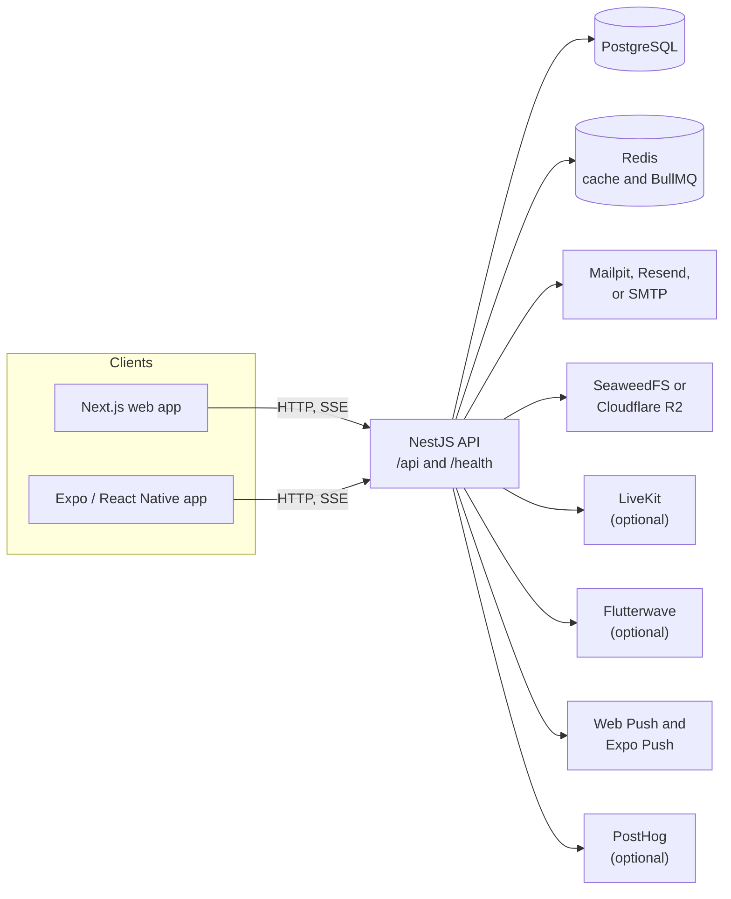
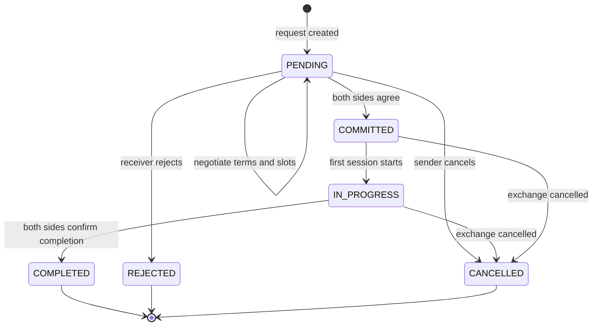

# Architecture

This document explains how the SkillEx monorepo fits together. It is a map, not
a full API reference. For decisions and their trade-offs, see the
[architecture decision records](./adr/). For every environment variable, see the
[environment-variable reference](./env-vars.md).

## System context

The web and mobile apps never talk to PostgreSQL, Redis, object storage, or
payment providers directly. They call the API, which owns credentials,
authorization, validation, and side effects.

## Repository layout

| Path                 | Purpose                                                                                |
| -------------------- | -------------------------------------------------------------------------------------- |
| `apps/web`           | Next.js App Router frontend, localized with `next-intl`                                |
| `apps/api`           | NestJS REST API, Prisma schema and migrations, Better Auth                             |
| `apps/mobile`        | Expo / React Native app with Expo Router and a native audio module                     |
| `packages/shared`    | Valibot schemas, TypeScript types, constants, analytics events, and currency utilities |
| `docs/`              | Architecture, environment, mobile, and legal documentation                             |
| `scripts/setup.mjs`  | One-command local setup                                                                |
| `docker-compose.yml` | Local PostgreSQL, Redis, Mailpit, SeaweedFS, and optional LiveKit                      |

The workspace is managed with pnpm and Turborepo. `@skillex/shared` is built
before the apps consume it; the API also runs `prisma generate` after install so
a clean checkout has generated Prisma types.

## Applications

### Web (`apps/web`)

- Next.js App Router with routes under `src/app/[locale]`. Supported locales are
  English, French, Spanish, and Portuguese.
- `next-intl` handles locale routing and translations. `src/proxy.ts` redirects
  non-localized paths to a locale.
- React Query manages client-side data fetching. Shared API hooks and types live
  in `packages/shared`.
- Better Auth's client talks to the API. Server components can call the API
  through `NEXT_PUBLIC_API_BASE_URL`; browser code uses
  `NEXT_PUBLIC_CLIENT_SIDE_API_BASE_URL`.
- `next.config.ts` proxies `/api/*` to the API and `/ph/*` to PostHog, which
  reduces ad-blocker interference for analytics.
- LiveKit components power the session room. Browser push uses the Web Push API
  with VAPID keys.
- `NEXT_PUBLIC_PRELAUNCH_MODE=true` gates marketplace pages behind a
  coming-soon state.

### API (`apps/api`)

The API is a NestJS application using Express. It exposes a global `/api`
prefix; the health check is the only route outside it (`/health`). It uses:

- **Prisma 7** with the PostgreSQL driver adapter for data access;
- **Better Auth** with the Prisma adapter for credentials and sessions;
- **Zod** for startup environment validation and **Valibot** for request
  validation;
- **Pino** for structured logging;
- **`@nestjs/throttler`** for rate limiting;
- **BullMQ** with Redis for the recording-timeout job; and
- **`@nestjs/schedule`** for periodic jobs.

| Module          | Responsibility                                                             |
| --------------- | -------------------------------------------------------------------------- |
| `auth`          | Better Auth configuration, session guard, OTP email hooks                  |
| `users`         | Profiles, avatars, user search, account settings                           |
| `skills`        | Skill catalogue, categories, user offerings and requests                   |
| `exchanges`     | Matchmaking, requests, negotiation, slots, sessions, chat, completion      |
| `points`        | Ledger, purchases, escrow, withdrawals, fees, referrals, recording billing |
| `reviews`       | Post-exchange ratings and tags                                             |
| `video`         | LiveKit tokens, room state, recording consent, egress, webhooks            |
| `notifications` | In-app notifications, web push, Expo push, email, reminders                |
| `uploads`       | Presigned S3/R2 uploads and avatar confirmation                            |
| `waitlist`      | Pre-launch waitlist and confirmation email                                 |
| `rates`         | Exchange-rate cache with fallback rates                                    |
| `analytics`     | Optional server-side PostHog events                                        |
| `email`         | Shared Resend / SMTP / Mailpit / disabled transport                        |
| `redis`         | Shared Redis client and BullMQ connection configuration                    |

### Mobile (`apps/mobile`)

- Expo / React Native with Expo Router and file-based navigation.
- Better Auth's Expo plugin, bearer tokens, and secure storage.
- LiveKit React Native WebRTC plus a local `audio-device-detector` Expo module
  with Android Kotlin and iOS Swift implementations.
- Expo push notifications, deep links, and a partial web target.
- Native modules require an Expo development build; Expo Go alone is not enough.
  See the [mobile development guide](./mobile-development.md).

### Shared (`packages/shared`)

- Valibot schemas used by the API and clients, so validation rules stay in one
  place.
- Shared DTOs, types, constants, and currency helpers.
- Canonical analytics event names and property types.
- React Query hooks used by the web app.

## Data and state

### PostgreSQL

Prisma models fall into these groups:

- **Identity:** `User`, `Session`, `Account`, `Verification`.
- **Catalogue:** `Category`, `Skill`, `UserSkill`.
- **Exchange lifecycle:** `ExchangeRequest`, `Exchange`, `ExchangeSession`,
  `ProposedSlot`, `Message`, `ExchangeChatMessage`, `SessionChatMessage`,
  `SessionChatReadReceipt`.
- **Money and incentives:** `PointsTransaction`, `AppConfig`, `Referral`.
- **Video:** `RecordingConsent`, `SessionRecording`.
- **Engagement:** `Review`, `Notification`, `PushSubscription`, `PushToken`,
  `WaitlistEntry`.

Migrations live in `apps/api/prisma/migrations`. The API container runs
`prisma migrate deploy` before starting.

### Redis

Redis has two roles:

1. A shared cache for exchange rates (`rates:USD`), with an in-memory fallback.
2. The BullMQ backend. The `recording-timeout` queue stops a recording when the
   points the user could afford have been used.

Redis is required for the full local stack and for multi-instance deployments.
The API still starts if Redis is temporarily unavailable, but jobs and shared
caching degrade.

### Object storage

`R2Service` talks to any S3-compatible store. Local development uses SeaweedFS;
production normally uses Cloudflare R2. Uploads use short-lived presigned PUT
URLs, and downloads use presigned GET URLs. The API derives the file extension
from the MIME type and scopes keys to the authenticated user, so clients cannot
choose arbitrary paths.

### Email

`EmailService` selects a transport at startup:

1. Resend when `RESEND_API_KEY` is set (or `EMAIL_TRANSPORT=resend`);
2. SMTP when `SMTP_HOST` is set (or `EMAIL_TRANSPORT=smtp`);
3. Mailpit on `localhost:1025` in development with no configuration; or
4. a no-op transport when disabled or when production has no configuration.

Sending never throws. Auth flows continue if email is temporarily unavailable,
and the failure is logged.

## Core flows

### Authentication and sessions

Better Auth stores users, accounts, sessions, and verification records through
Prisma. Email/password sign-up requires email verification. Verification and
password-reset codes are delivered by `EmailService` as one-time passwords.

Google and LinkedIn are registered only when both values of the provider pair
are present. The mobile app uses Better Auth's Expo plugin and bearer tokens.
Trusted origins include `CLIENT_BASE_URL`, the configured Expo scheme, and
development-only localhost/private-network patterns. `DEV_EXTRA_ORIGINS` adds
explicit development tunnel origins.

A Better Auth hook blocks direct changes to a user's `image` field unless the
request carries the internal server secret. This forces avatar changes through
the presigned-upload flow.

### Exchange lifecycle

1. A user creates an `ExchangeRequest` with the requested skill, an optional
   offered skill, session counts and durations, and an optional points proposal.
2. The participants negotiate through structured messages and proposed slots.
   Points can be proposed by either side, but the payer must be one of the two
   participants and must have enough balance.
3. When both sides agree, the request is claimed atomically and becomes an
   `Exchange`. If points are involved, the payer's points are locked in escrow
   in the same transaction.
4. Each `ExchangeSession` has a scheduled time, duration, status, and chat.
   Participants mark sessions completed or missed.
5. When both participants confirm the exchange is complete, escrow is released
   to the teacher minus the platform commission, facilitation fees are applied,
   referral bonuses are processed, and reviews become available.
6. Reviews are unique per reviewer and exchange. They include a rating and
   optional tags.

### Points and payments

Points are the internal unit of account. `User.pointsBalance` is the current
balance; every change is also recorded in `PointsTransaction` with a type and
status. A singleton `AppConfig` row controls commission, facilitation fees,
withdrawal spread, minimums, referral rewards, recording rate, and prelaunch
mode.

**Purchases.** A user buys at least the configured minimum. The API creates a
`PENDING` purchase transaction and either starts a Flutterwave checkout or, in
non-production with no Flutterwave keys, credits the points through the local
mock. The Flutterwave webhook verifies the `verif-hash` header with a
constant-time comparison, checks the amount and currency against the stored
transaction, and credits the user exactly once. Duplicate deliveries are
ignored.

**Escrow.** Committing an exchange with points locks the payer's balance and
marks the exchange as escrowed. Completion releases the points to the teacher
minus commission. The release path is idempotent so a retry cannot pay twice.

**Withdrawals.** Withdrawals require the configured minimum and apply the
configured spread. Purchases made with an international payment method are
locked for a cooling-off period to prevent arbitrage. The API deducts points,
initiates a Flutterwave transfer, and refunds the points if the transfer fails.
The local mock completes withdrawals without an external call.

**Referrals.** Each user can have a referral code. A code can be applied only
near sign-up time. Rewards are paid after the referee's first completed
exchange, subject to per-referral and monthly caps. Reward writes are serialized
per referrer to keep the cap accurate under concurrency.

**Recording fees.** Recording locks points up front based on the configured
per-minute rate and the minutes the user can afford. When recording ends, the
actual duration is settled and unused points are refunded.

### Live video and recordings

LiveKit is optional. The API issues an access token only after checking that the
user belongs to the exchange session and that the session is within its allowed
time window. The LiveKit room name is the exchange session ID.

Recording requires explicit consent from both participants. When recording
starts, the API starts a room-composite egress, creates a `SessionRecording`,
and locks points. A BullMQ job stops the recording when the affordable time is
used. LiveKit's `egress_ended` webhook settles the final duration and refunds
unused points. Recording files expire after the configured retention period.

LiveKit webhooks are verified with the LiveKit SDK using the raw request body.
The API accepts `application/webhook+json` in addition to `application/json` for
this endpoint.

### Notifications

Domain services emit events such as `exchange.updated`, `session.updated`, and
`points.purchased`. `NotificationsListener` turns them into notifications for
the relevant users. `NotificationsService` respects each user's in-app, push,
and email preferences and can deliver through:

- the in-app notification table and SSE stream;
- Web Push subscriptions with VAPID keys;
- Expo push tokens for iOS and Android; and
- transactional email for critical events.

A scheduled job checks every five minutes for sessions starting within the next
fifteen minutes and sends reminders. Invalid Expo tokens and expired web-push
subscriptions are removed.

### Waitlist and rates

The waitlist endpoint is public and throttled. Duplicate emails return a success
response without creating a second entry, and a confirmation email is sent when
the transport is enabled.

Exchange rates are fetched from Open Exchange Rates when `OER_APP_ID` is set,
cached in Redis, and refreshed every four hours. Without OER, the API uses
transparent fallback rates. If Redis is unavailable, it keeps the last known
rates in memory.

## Security controls

- **Startup validation:** `validateEnv` rejects missing required values,
  placeholders, malformed URLs, and partially configured integration groups
  before the API starts.
- **Fail closed:** the internal avatar-update secret and the Flutterwave webhook
  secret are rejected when unset. Neither is compared with `===`.
- **CORS and trusted origins:** production allows `CLIENT_BASE_URL`; development
  adds localhost, loopback, and explicit `DEV_EXTRA_ORIGINS`.
- **Rate limiting:** a global limit plus tighter limits on auth, waitlist,
  uploads, purchases, withdrawals, chat, and webhooks.
- **Request validation:** Valibot schemas from `@skillex/shared` validate request
  bodies and query parameters.
- **Upload policy:** server-derived keys and MIME allowlists prevent path
  traversal and unexpected file types.
- **Webhook checks:** signature verification, amount and currency checks, and
  idempotent state transitions.
- **Secrets:** `.env` files are gitignored; only example files are committed.
  Never put secrets in `NEXT_PUBLIC_*` or `EXPO_PUBLIC_*` variables, because they
  are embedded in client bundles.

For vulnerability reporting, see [`SECURITY.md`](../SECURITY.md).

## Deployment

### Local

`pnpm run setup` creates the env files, starts the Compose services, builds the
shared package, generates Prisma, applies migrations, and seeds demo data. The
API and web app then run with `pnpm dev`.

### API

The root `Dockerfile` builds the shared package and the NestJS API, prunes
development dependencies, and starts the API through
`apps/api/scripts/start.sh`, which runs `prisma migrate deploy` before boot.
`render.yaml` describes a Docker-based API service with `/health` as its health
check.

### Web

The web app is a standard Next.js application. It can run on Vercel or any Node
host. `NEXT_PUBLIC_API_BASE_URL` must point at the API, and
`NEXT_PUBLIC_CLIENT_BASE_URL` must be the public web origin.

### Mobile

The mobile app uses Expo development builds and EAS or local native builds.
iOS-native builds, signing, store submissions, and LiveKit native upgrades are
maintainer-led. The repository includes manual macOS GitHub Actions workflows
for unsigned iOS IPA builds.

### Managed services

Production normally uses managed PostgreSQL and Redis, Cloudflare R2 for
storage, LiveKit Cloud for video, Flutterwave for payments, and Resend for
email. Every one of those integrations is optional at the code level, but a
production deployment should configure the ones it depends on.

## Known constraints

These are known gaps, not hidden behavior:

- Rate-limit counters are stored in memory. A multi-instance deployment needs a
  shared Redis-backed throttler storage.
- A withdrawal request that times out at the HTTP layer may still be accepted by
  Flutterwave. The refund path needs a reconciliation check against the final
  transfer status.
- The web, mobile, and shared packages do not have full test suites yet. The API
  has service-level tests that contributors can copy.
- Mobile native builds are not part of PR CI. JS/TS lint and typecheck run in
  CI where practical; device testing is described in pull requests.
- Docker Compose and the dev container are validated manually. CI validates
  install, lint, formatting, typecheck, tests, and the production build.

## References

- [`docs/adr/`](./adr/) — architecture decisions
- [`docs/env-vars.md`](./env-vars.md) — environment-variable reference
- [`docs/mobile-development.md`](./mobile-development.md) — mobile setup and testing
- [`CONTRIBUTING.md`](../CONTRIBUTING.md) — contribution process
- [`SECURITY.md`](../SECURITY.md) — vulnerability reporting
